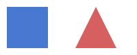

# Getting started with shapes

This tutorial sits next to the code it describes, in `src/+demo/`. It is a
Markdown page: `scmd apidoc` renders it on the namespace's page,
under "Sidecar docs".



## Make a shape

Create a [`demo.Shape`](@Shape/Shape.m) and scale it with
{mat:meth}`demo.Shape.scale`:

```matlab
s = demo.Shape("square", 2);
s = s.scale(3);
```

## Measure

[](+geometry/distance.m) gives the distance between two points. The
[notes on the utilities](../utils/notes.rst) explain the helpers.
